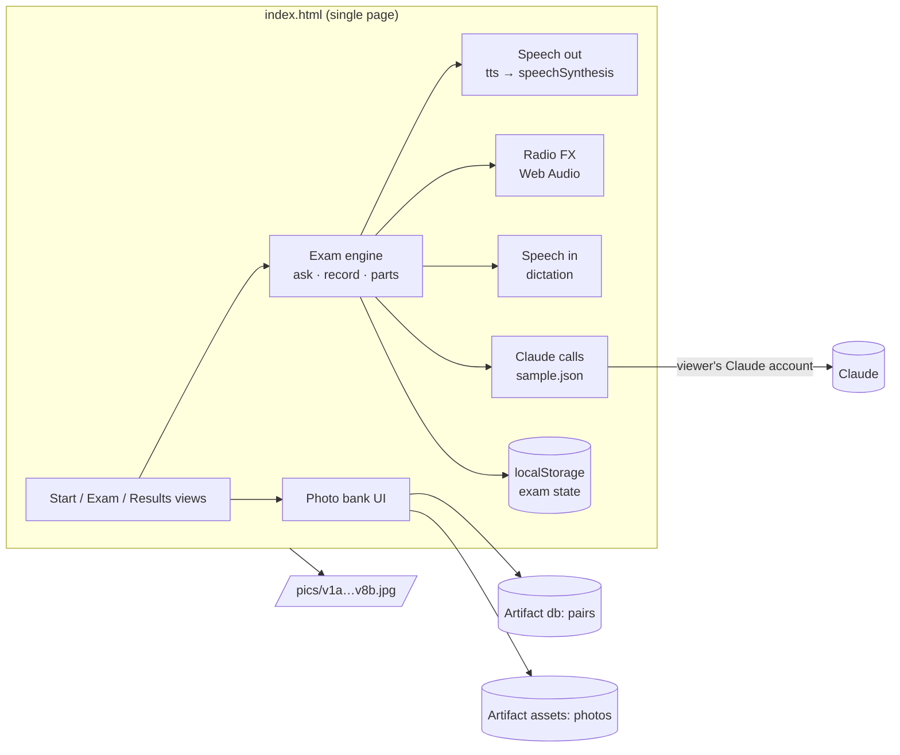
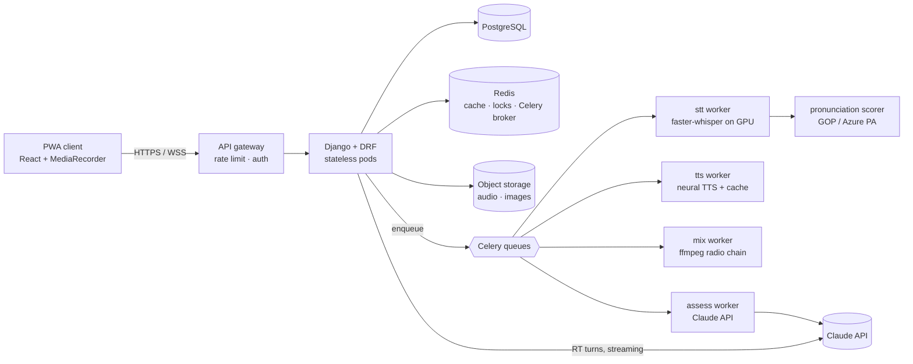

# ELPAT Simulator: Architecture

The simulator runs a full ELPAT (English Language Proficiency Aviation Test) as a spoken, timed exam: four parts, one item at a time, voice answers, and an ICAO Doc 9835 rating at the end.

The same page (`index.html`) runs in three places:

| | **A. claude.ai artifact** (live) | **A′. Standalone HTTPS app** (`standalone/`, built) | **B. Scaled service** (design below) |
|---|---|---|---|
| Who can use it | People you share the link with who have a Claude account | Anyone with the URL, with an optional access code | Anyone, with accounts |
| Examiner and rating | Claude on the viewer's account (`sample`) | Claude API through the Django proxy | Claude API from workers |
| Recording (getUserMedia + MediaRecorder) | **Blocked by the artifact frame.** The page detects it and falls back to dictation | **Yes**: per-answer WebM/Opus or MP4/AAC, with PLAYBACK and RE-RECORD before SAVE ANSWER | Yes, uploaded to object storage |
| Speech-to-text | Claude dictation (live) | Whisper or Deepgram on each recording | Whisper on a GPU pool plus phoneme-level scoring |
| Recordings stored | – | In the candidate's browser (IndexedDB) | S3, with a retention policy |
| Pronunciation rating | From speech-to-text evidence | From speech-to-text evidence | Acoustic |

## Recording system (shared by A and A′)

- **Controls:** RECORD, STOP, PLAYBACK, RE-RECORD, SAVE ANSWER, plus REPLAY Q (SAY AGAIN in Part 4). A take is never submitted on STOP: the candidate reviews it, can listen back and re-record, and submits with SAVE ANSWER.
- **Capture:** `getUserMedia({audio: {echoCancellation, noiseSuppression, autoGainControl, channelCount: 1}})` starts inside the RECORD click. The format is the first one `MediaRecorder.isTypeSupported` accepts from `audio/webm;codecs=opus`, `audio/webm`, `audio/mp4`, `audio/aac`, `audio/ogg;codecs=opus`. Chunks are taken every second (`start(1000)`) so Android tab suspension does not lose data. An `AnalyserNode` drives the level meter and detects speech start and end for the fluency metrics.
- **Release:** tracks are stopped after every take. On Android an open microphone puts audio in call mode and lowers the examiner's volume.
- **Detection before and after the first attempt:** secure context, presence of `getUserMedia` and `MediaRecorder`, `document.permissionsPolicy.allowsFeature("microphone")`, the Permissions API state, and the error name (`NotAllowedError` in a frame → frame-blocked, `NotReadableError` → mic busy, `NotFoundError` → no device, `OverconstrainedError` → retry with `{audio: true}`). Each case shows a clear message, and the start screen has a diagnostics panel.
- **Storage:** each saved answer's Blob goes to IndexedDB under `examId:questionKey`. The results page plays and downloads each one.
- **Transcription:** in A′ the upload starts on STOP, so SAVE ANSWER is usually instant. If it fails, the take stays in review with a retry. In A, dictation runs alongside the recorder; if the recorder is blocked, the take is text-only.

---

## A. Current implementation (claude.ai artifact)

### Components

### How each requirement is implemented

| Requirement | Implementation |
|---|---|
| Questions spoken aloud | `speakLines()` sends each line to `tts.speak()` with a voice per speaker: examiner `rounded`, ATC `glassy`, pilot `airy`, other aircraft `buttery`. If Claude voices are unavailable (Safari, mobile apps), it falls back to `speechSynthesis` with a distinct voice and pitch per speaker. |
| ANSWER / SPEAK and STOP | `ANSWER` (`SPEAK` in Part 4) opens the microphone. `STOP` ends the answer. The engine never moves on before STOP, and the examiner never interrupts. A safety cap of 2 × the suggested time + 60 s handles a forgotten STOP. |
| Speech-to-text | `dictation.start()` runs synchronously inside the button click, because the platform only opens the mic from a tap. `onFinal` and `onPartial` build the transcript live. `stop()` resolves once the last words are in. |
| One item at a time | `ask()` primitive: render the item → speak it → wait for ANSWER (REPLAY is counted) → record → STOP → persist. |
| Part 2 images | 8 built-in normal/abnormal photo pairs (`pics/`) with examiner notes written per picture. Alternatives: Claude-drawn SVGs (sanitised with DOMPurify), or the owner's photo bank (assets + db, where Claude vision writes the hidden notes once per pair). |
| Picture timing | Stage A: 1 min. Stage B: 2 min. Stage C: three recorded candidate questions, each answered in character by the examiner. Stage D: three discussion questions, each generated from the previous answer. |
| Listening, about 2 min | Claude writes a 260–320-word multi-speaker script with numbers spelled as spoken on the radio, plus questions and an answer key. |
| Noise, static, interference | `fx` module. Static is band-passed white noise with crackle. Rotor is brown noise amplitude-modulated at 4.6 Hz (blade slap). Jet is low-passed rumble plus hiss. Wind is a swept band-pass. Squelch bursts play on every key-up and key-down. Random heterodyne whistles simulate interference. Beds switch on each `tts.onLine` event, so noise follows the speaker. Levels: off, light, realistic. |
| Max two plays, notes, hidden transcript | The play counter is persisted. Each play is followed by 30 s of note-taking time. Notes stay visible during the questions. Transcripts and answer keys appear only on the results page. |
| RT role-play | Scenario brief, then a loop of 12 candidate transmissions. Each turn is one Claude call that returns the readback check (expected, ok, issues), the stage (1 standard, 2 abnormal, 3 safety), an optional cue card, the next transmission and an end flag. The full radio log is sent each time, so ATC reacts to what was actually said. |
| ICAO assessment | One call to the `complex` model tier with every answer and its measurements, the listening keys and the readback checks. The client enforces **overall = min(criteria)** regardless of what the model returns. |
| Timers | Exam clock, part clock against target (P1 3 min, P2 10, P3 10, P4 15; turns amber when over), and a per-answer countdown that becomes an over-time count. |
| Results dashboard | Overall level, six criterion bars, speech metrics (wpm, first-word delay, over-time, replays, readback %), strengths and weaknesses, grammar table, phraseology table, RT readback table, vocabulary, suggestions, part summaries, transcripts and a markdown export (`downloads`). |

### Exam state and resilience

- **State** lives in `localStorage` (`elpat-exam-v3`): `cfg`, `content` (generated questions, pictures, scripts, RT brief), `answers[]`, `done{}` checkpoints, `plays`, `notes`, `rt{log, checks, next}`, `result`.
- **Resume:** every step is idempotent. `ask()` returns a stored answer, `stepOnce()` skips completed side effects, and `cached()` reuses generated content. A reload can therefore continue mid-part.
- **Prefetch:** while the candidate answers Part 1, a serial background queue generates the Part 2 pictures, both listening scripts and the RT brief. It is serial so it never floods the model.
- **Cancellation:** each async helper captures a generation number. "New exam" increments it, so stale continuations throw `Abort` instead of writing into the new exam.
- **Failures:** Claude errors show a RETRY panel with a reason (`not_granted`, `rate_limited`, …). Microphone failures show the exact cause, a permissions button, a copy-link option for Chrome, and "type this answer instead". Typed answers are flagged so they are not rated for pronunciation or fluency.

### Known limits of target A

1. **No raw audio in the artifact.** The frame refuses `getUserMedia`/MediaRecorder, and dictation returns text only. The page detects this and says so. Use target A′ (`standalone/`) for real recordings.
2. **Noise is synchronised, not baked in.** Claude voices play through the platform, so the Web Audio noise runs alongside the voice rather than in one file.
3. **Claude mobile app:** no microphone and no Claude voices. Use Chrome. The page explains this and still works by typing.
4. Ratings are **indicative**. They are not calibrated against certified raters.

---

## B. Scaled production architecture (beyond `standalone/`)

`standalone/` (A′) already gives you public access, real recordings and server-side transcription. Build B when you also need server-side audio storage, acoustic pronunciation scoring, candidate accounts and history, or institutional scale.

### Domain model (PostgreSQL)

- `Candidate(id, role, aircraft_or_unit, locale)`
- `ExamSession(id, candidate, mode, status, started_at, finished_at, config jsonb)`
- `ExamItem(id, session, part, stage, seq, prompt, assets jsonb, soft_limit_s)`: the unit "one question at a time".
- `Response(id, item, audio_key, duration_ms, transcript, words jsonb[word, start, end, conf], metrics jsonb, replays, typed bool)`
- `ListeningAsset(id, script jsonb, audio_key, questions jsonb, key jsonb, plays_allowed=2)`
- `RtTurn(id, session, seq, stage, cue, ai_text, ai_audio_key, response FK, check jsonb)`
- `Assessment(id, session, overall, criteria jsonb, report jsonb, model, rubric_version)`

Indexes: `(session_id, seq)` on items and turns, plus a partial index on `ExamSession(status) WHERE status='in_progress'` for the resume and cleanup jobs.

### Request flow for one answer

1. The client records `audio/webm;codecs=opus` with MediaRecorder, showing a live level meter through an AudioWorklet.
2. It uploads to a pre-signed S3 URL (multipart above 5 MB), then calls `POST /items/{id}/responses` with an idempotency key.
3. The API stores the `Response` (status `uploaded`) and enqueues `stt`. The client advances only after STOP, never on a timer.
4. The `stt` worker validates the file with `ffprobe`, runs Whisper large-v3 with word timestamps and an aviation vocabulary prompt (callsigns, NATO alphabet, ICAO terms), then computes fluency metrics: speech rate, articulation rate, pause ratio, mean length of run, first-word latency.
5. A `pron` subtask scores phonemes (GOP on wav2vec2, or Azure Pronunciation Assessment) for an acoustic pronunciation signal.
6. Results are stored. The client is notified over WebSocket (Django Channels) or by polling.

### Listening audio pipeline

- The script is generated with Claude using structured output (JSON schema via tool use).
- Each line is sent to TTS with a voice per role, cached by `sha256(voice|text|rate)`.
- ffmpeg radio chain per transmission: high-pass at 300 Hz, low-pass at 3.4 kHz, light compression and saturation, squelch head and tail.
- A noise bed is mixed underneath per speaker: cockpit or rotor, wind, static, occasional heterodyne.
- Output is loudness-normalised to −16 LUFS, encoded to Opus/MP3 and served with short-lived signed URLs.
- The two-play limit is enforced server-side (a `plays` counter on the session item), not only in the UI.

### RT role-play

- Latency budget: under 2.5 s from STOP to the start of ATC audio.
- STT runs on the short transmission first.
- The Claude turn call is streamed, with the static rubric and scenario held in a **prompt cache** and only the radio log appended.
- The first sentence goes to TTS as soon as it arrives.
- The readback check is stored per turn for the report.

### Assessment

- One Claude call with structured output, using a versioned rubric containing the ICAO holistic descriptors.
- Inputs: transcripts with word timings, acoustic pronunciation scores, listening answers against the key, and RT checks.
- `overall = min(criteria)` is enforced in code.
- Calibrate against double-rated human samples: track a weighted Cohen's κ per criterion and keep `rubric_version` on every assessment.

### Scale and operations

- **Stateless API pods** behind a gateway, with Redis token-bucket rate limits per user and per IP. Celery queues are split (`stt`, `tts`, `mix`, `assess`) and autoscaled on queue depth (KEDA). STT runs on a GPU node pool and everything else on CPU.
- **Load:** an exam is about 30 uploads and about 60 model calls over 30 minutes, so 1 000 concurrent candidates means roughly 17 STT jobs per second at peak. Size GPU workers from measured real-time factor, with faster-whisper at about 0.1× RTF on an L4.
- **Observability:** OpenTelemetry traces from API to worker to vendor, and Prometheus metrics (STT latency, sampled WER, LLM tokens and cost per exam, TTS cache hit rate). Use Sentry for errors.
- **Security and privacy:** OAuth2 or session auth with per-candidate row isolation. Audio is encrypted at rest and kept for 30 days by default, with an explicit consent screen. Uploads are validated by content sniffing, size and duration caps. Signed URLs only. Secrets live in a vault. Apply the OWASP ASVS L2 checklist.
- **Delivery:** Docker images, Kubernetes, Terraform. CI runs lint, unit and integration tests with recorded vendor fixtures. CD uses canary releases.

### Migration path from target A

The prompts, the JSON contracts (questions, listening script, RT turn, assessment) and the scoring rules in `index.html` carry over unchanged. Target B replaces the I/O layer:

- `dictation` becomes upload plus STT
- `tts` becomes server TTS
- `fx` becomes ffmpeg mixing
- `localStorage` becomes PostgreSQL
